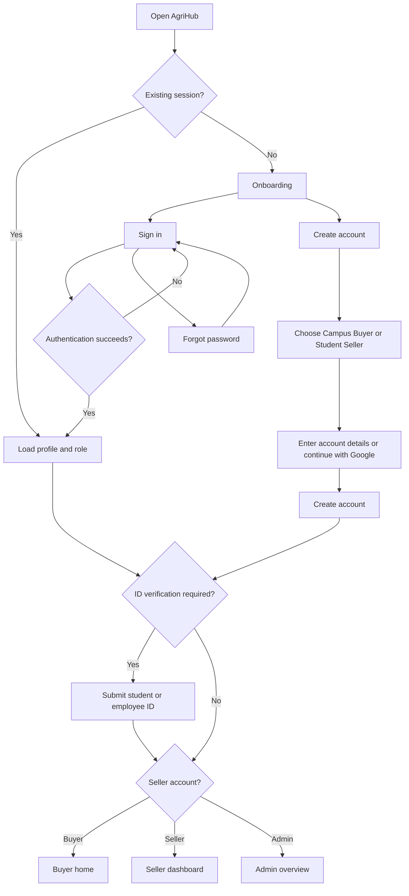
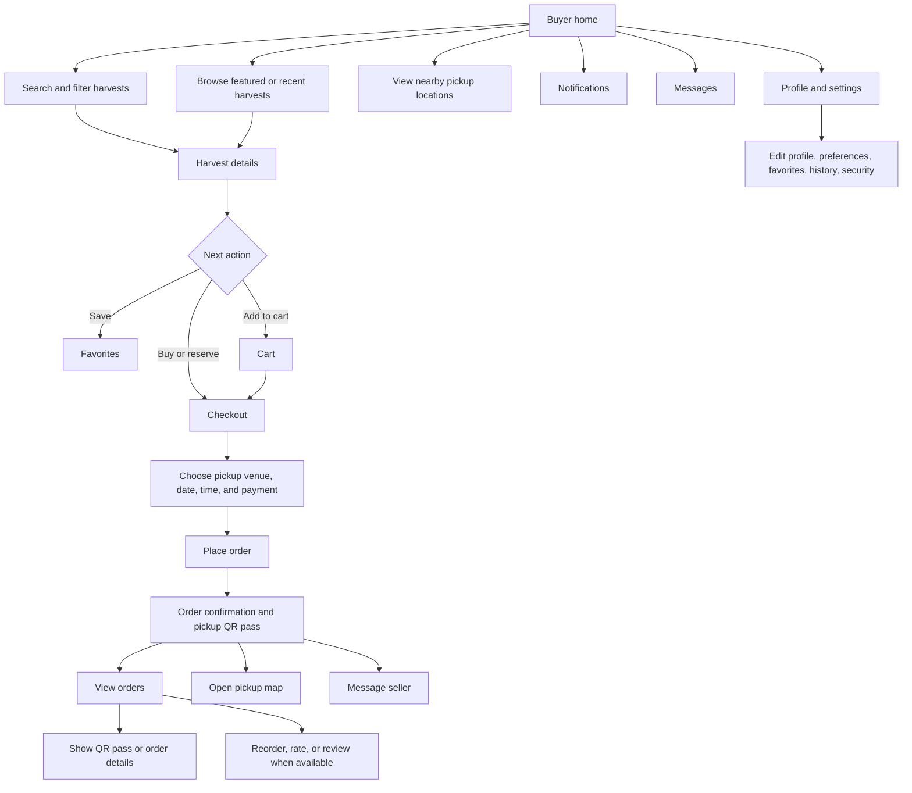
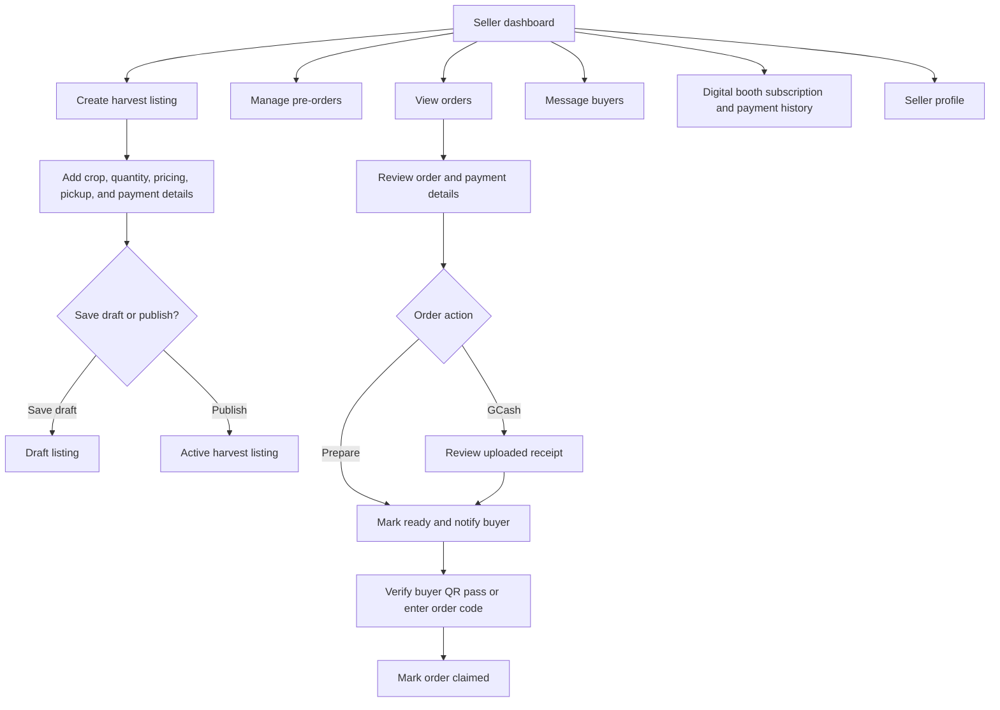
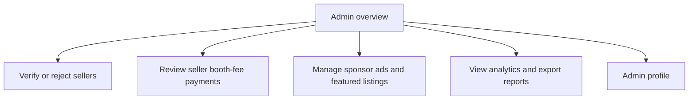

# AgriHub User Flow and App Flow

This document describes the current user journeys and navigation structure implemented in AgriHub. It is based on the Expo Router screens and layouts in `src/app`.

## 1. User flow

### Entry, onboarding, and account access



The app restores the Supabase session and loads the user's profile before routing. Buyers may be asked to verify an ID when their profile requires it; seller access requires ID information. Admin accounts enter the admin area directly.

### Buyer journey



### Seller journey



### Admin journey



## 2. App flow and route structure

```mermaid
flowchart TD
    ROOT[src/app/_layout.tsx<br/>Session and profile bootstrap] --> PUBLIC[Public auth routes]
    ROOT --> BUYER[Buyer tabs]
    ROOT --> SELLER[Seller tabs]
    ROOT --> ADMIN[Admin tabs]

    PUBLIC --> ONBOARD[/auth/onboarding]
    PUBLIC --> LOGIN[/auth/login]
    PUBLIC --> REGISTER[/auth/register]
    PUBLIC --> RESET[/auth/reset-password]
    PUBLIC --> VERIFY[/auth/verify-id]

    LOGIN --> ROLE{Loaded profile role}
    REGISTER --> ROLE
    VERIFY --> ROLE
    ROLE -- buyer --> BUYER
    ROLE -- seller --> SELLER
    ROLE -- admin --> ADMIN

    BUYER --> BHOME[/buyer]
    BUYER --> BSEARCH[/buyer/search]
    BUYER --> BCART[/buyer/cart]
    BUYER --> BMESSAGE[/buyer/message]
    BUYER --> BPROFILE[/buyer/profile]
    BHOME --> BDETAIL[/buyer/harvest/[id]]
    BSEARCH --> BDETAIL
    BDETAIL --> BCART
    BDETAIL --> CHECKOUT[/buyer/checkout]
    BCART --> CHECKOUT
    CHECKOUT --> SUCCESS[/buyer/order-success/[id]]
    BPROFILE --> BSECOND[History, favorites, map, settings,<br/>security, and notifications]

    SELLER --> SHOME[/seller]
    SELLER --> SORDERS[/seller/orders]
    SELLER --> SPOST[/seller/post-harvest]
    SELLER --> SPROFILE[/seller/profile]
    SHOME --> SPRE[/seller/pre-orders]
    SHOME --> SMESSAGE[/seller/messages]
    SHOME --> SSUB[/seller/subscription]

    ADMIN --> AHOME[/admin]
    ADMIN --> AVERIFY[/admin/verification]
    ADMIN --> APAY[/admin/payments]
    ADMIN --> AMON[/admin/monetization]
    ADMIN --> AANALYTICS[/admin/analytics]
    ADMIN --> APROFILE[/admin/profile]

    BUYER -. order conversation .-> CHAT[/chat/[orderId]]
    BPROFILE -. edit account .-> EDIT[/profile/edit]
    SPROFILE -. edit account .-> EDIT
    EDIT -. return to role home .-> ROLE
```

### Navigation notes

- The root layout restores the Supabase session, fetches the profile role, and directs signed-in users to their role area. Unauthenticated users arriving at the app root are sent to onboarding.
- Buyer, seller, and admin areas use bottom-tab navigation. Several buyer and seller screens are nested routes rather than visible tabs.
- The seller layout checks that the current user has the seller role and required ID information before rendering seller tabs.
- Buyer checkout leads to an order confirmation screen with order details and a pickup QR pass. Order/payment options depend on the listing and checkout state.
- `auth/role-select` provides role selection (Campus Buyer or Student Seller), department assignment, and profile completion for newly authenticated Google users before granting access to role dashboards.
